# Ордо

Стратегия о степи и городе: Кокандское ханство и кыпчаки ([ТЗ](docs/TZ.md)). В игре главное меню и два режима:

- **«Сражение»** — срез стиля, одобренный автором: лагерь кыпчаков на закате и столкновение двух отрядов —
  кокандские сарбозы с мылтыками против кыпчакских сайыскеров и полководца Колбашчы.
- **«Город»** — первая играбельная сборка: за Коканд или за кыпчаков против ИИ. Хозяйство, стройка, стены
  и ворота, набеги, көч и олжо, победа и поражение.

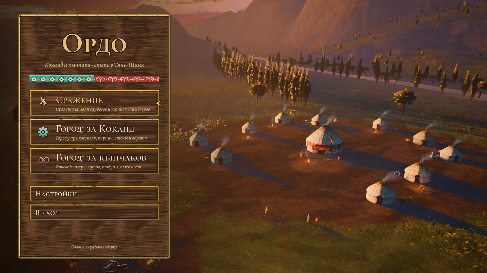

| | |
|---|---|
| 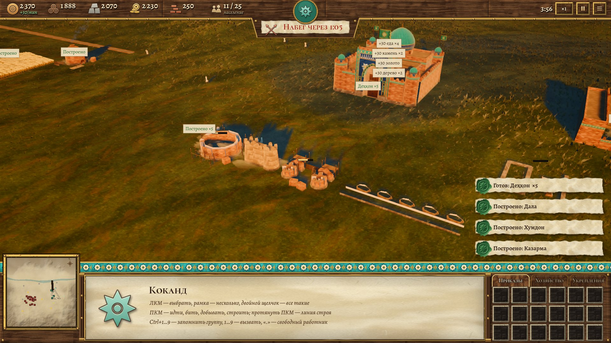 | 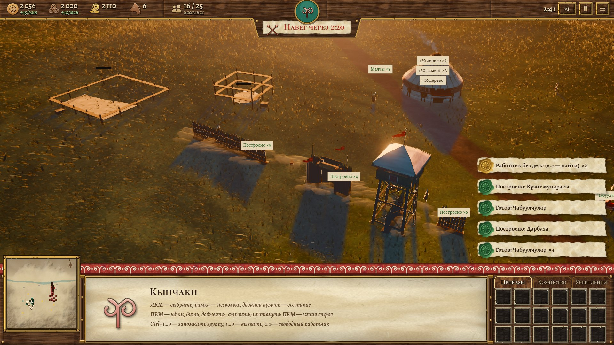 |
| 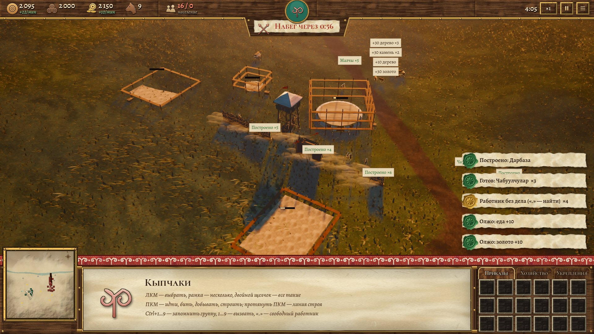 | 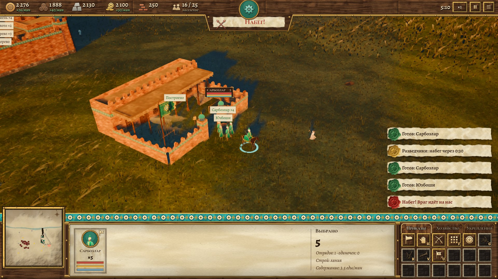 |
| 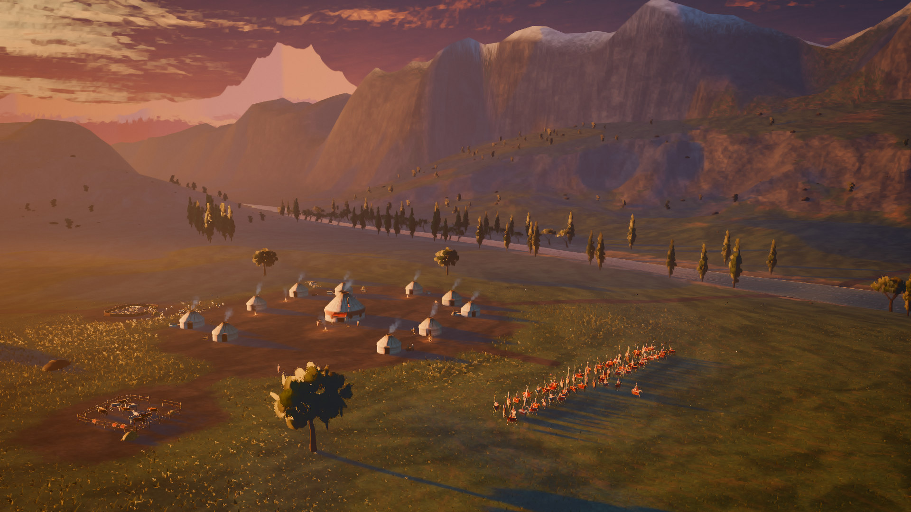 | 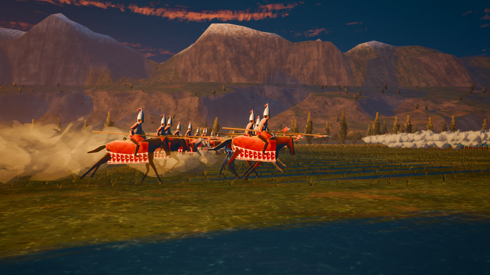 |

## Как поиграть

**Windows.** Установщик и версия без установки — на странице
[Releases](https://github.com/Keepich1/KAGANFILM/releases) репозитория (собираются сами при каждом
изменении папки `ordo/`). При первом запуске Windows скажет «Windows защитила ваш компьютер» —
«Подробнее» → «Выполнить в любом случае»: у файла пока нет цифровой подписи.

**Из исходников (любая система).** Скачать [Godot 4.7.2](https://godotengine.org/download),
открыть `ordo/project.godot`, нажать F5 — откроется главное меню.

### Главное меню

| Пункт | Что это |
|---|---|
| Сражение | срез стиля (Esc — назад в меню) |
| Город: за Коканд | город у арыков: поля, кирпич, стены и ворота |
| Город: за кыпчаков | кочевой лагерь: юрты, табуны, олжо и көч |
| Настройки | качество графики (как F2), громкость, во весь экран |
| Выход | |

## «Город»: как играть

Вы — игрок 0 со своей ставкой (Урда у Коканда на восточном лугу, Ордо у кыпчаков на западе), ИИ — другая
сторона со своей базой, гарнизоном и двумя башнями.

1. **Работники.** Выберите ставку и наймите работников (деҳқон / малчы). ПКМ работником по дереву, камню,
   золоту, полю или короо — добыча; они сами носят ношу на склад.
2. **Стройка.** Вкладка «Хозяйство» (B): призрак зелёный — можно, красный — нельзя (занято, склон, вода,
   чужая земля). Поля Коканда родят полностью только у арыка — призрак поля синий; дальше — «лалми», 25%.
   Хумдон (печь) — тоже у воды: дрова в кирпич, кирпич — на Тош девор и Бурж.
3. **Укрепления.** Вкладка «Укрепления»: стена — щелчками по точкам (ПКМ или Esc — конец), ворота и
   башня — на свою стену (звенья под ними уходят). Свои проходят в ворота, враг ищет обход, а если его нет —
   ломает звено.
4. **Население и еда.** Жильё (Уй, Боз үй) поднимает предел населения. Войско ест (содержание); без еды —
   голод: атака и выносливость падают, потом бегут дезертиры.
5. **Кыпчаки.** Кони — ресурс конницы (табун в Жылкы короосу растёт); отары кормят у короо, трава
   вытаптывается — перегоните. K / Shift+K — свернуть юрту / весь лагерь в арбы (көч), K с арбами —
   развернуть у курсора. За убитых и разрушенное — олжо (золото и еда).
6. **Набеги.** Через 5 минут приходит первый набег ИИ (таймер наверху — «Набег через …»), дальше каждые
   2,5–4 минуты, всё крупнее. Налётчики бьют работников, поля, склады, угоняют стада.
7. **Войско.** Наймите бойцов (Казарма у Коканда, Жылкы короосу и Жоокер үйү у кыпчаков) и офицера;
   U — собрать отряд с офицером, U ещё раз — распустить.
8. **Победа и поражение.** Снесите вражескую ставку — победа. Потеряете свою (у кыпчаков — и арбу с ордо
   в пути) — поражение. На экране конца — «Ещё раз» или «В главное меню».

### «Город»: управление

| Клавиши | Действие |
|---|---|
| ЛКМ / рамка / двойной щелчок | выбрать / несколько / все такие на экране |
| ПКМ | идти, бить, добывать, строить (по смыслу) |
| ПКМ и протянуть | линия строя и разворот |
| Двойной ПКМ | бегом / галопом |
| Shift | в очередь; Shift+ЛКМ — поставить ещё одну постройку |
| F · H · G | строй · стой · качып атуу |
| R · V · U | огонь / рукопашная · клич · собрать или распустить отряд |
| K · Shift+K · K с арбами | свернуть юрту · весь лагерь · развернуть у курсора |
| B, буквы · колесо или R | постройки · повернуть постройку |
| «.» · N | свободный работник · тревога |
| Ctrl+1…9 · 1…9 | запомнить · вызвать группу |
| W A S D, края экрана, колесо, Q / E | камера; F5–F8 — виды: ставка, ближе, вся долина, ставка врага |
| P · + / − | пауза · скорость |
| Del | снести постройку |
| Esc · F10 | отмена · меню паузы (продолжить, управление, начать заново, в главное меню) |

## «Сражение»: срез стиля

Этап 0 из ТЗ — сцена, на которой согласован стиль: «живописный» свет (граница света ломается мазком, тени
цветные, тёплая полоса на границе света, контровой свет), рисованные текстуры, туман в низинах, лучи, тени
облаков; лагерь кыпчаков с боз үй, хан ордосу, тугом, загонами, кострами и дымом; анимации юнитов на
видеокарте; детерминированный бой (мораль, выносливость, натиск, залпы, клич полководца, бегство).

| | |
|---|---|
| 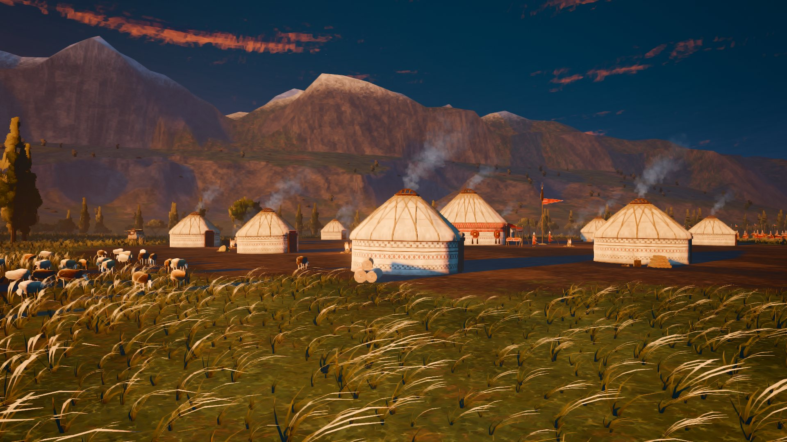 | 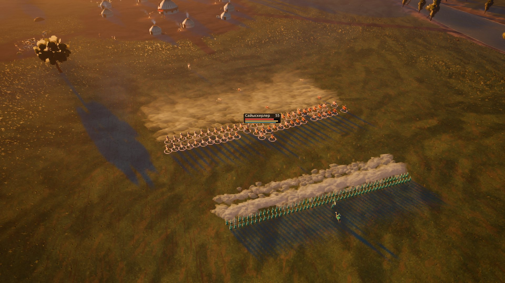 |
| 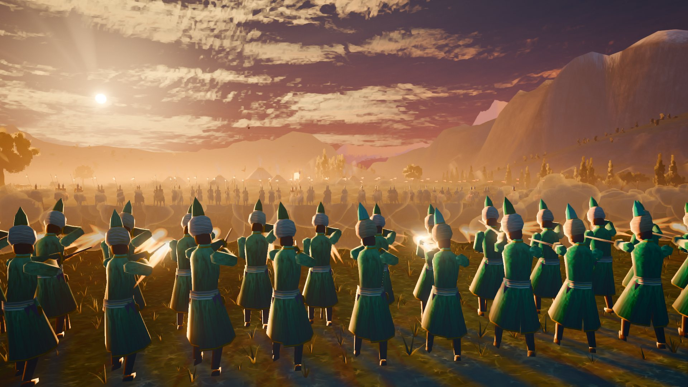 | 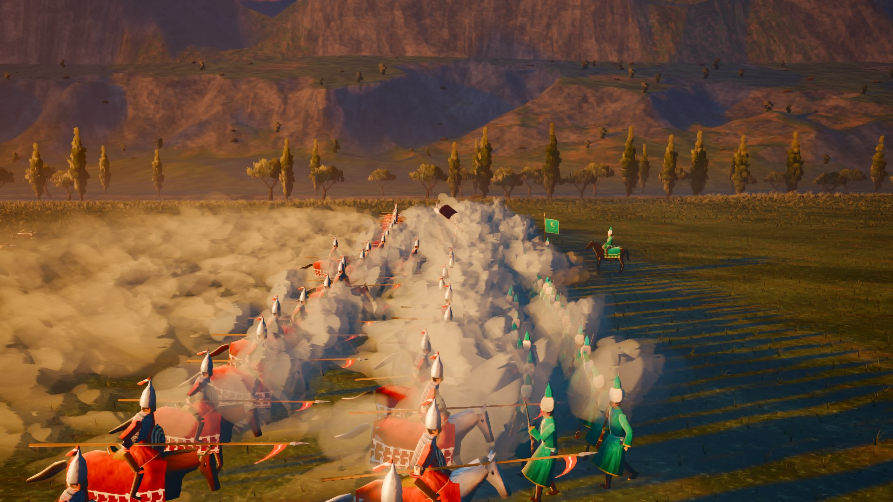 |

| Клавиши | Действие |
|---|---|
| W A S D, края экрана | сдвиг камеры |
| Колесо | ближе / дальше |
| Q / E, средняя кнопка | поворот и наклон камеры |
| 1–4 | готовые виды: всё поле, кокандская линия, конница, лагерь |
| C | кинокамера / камера стратегии |
| ЛКМ (двойной щелчок) | выбрать отряд (все такие) |
| P, + / − | пауза, скорость боя |
| R | бой заново |
| F1 | подсказка |
| F2 | качество «Высокое» → «Среднее» → «Низкое» (ТЗ 11.7) |
| F9 | проверка скорости: +1000 → +3000 солдат → выкл, со счётчиком кадров |
| Esc | в главное меню |

## Что ещё не сделано (честно)

- **ИИ без своей экономики** (ТЗ §16.2, этап 3): база ИИ стоит готовой, набеги — «даровые» волны.
  ИИ не строит и не нанимает: его волны бьют по хозяйству (ставку ломают только большие волны), а победа —
  снести его ставку своим войском.
- **Скорость.** Расчёт тел пока на GDScript: город с ~900 юнитами — около 13 мс на такт (цель 3 мс).
  В обычной партии (десятки–сотни юнитов) этого хватает; перенос ядра на C++ (BattleCore) — следующий шаг.
- **Свет «Города»** — тот же живописный закат, но солнце выше (16° вместо 10° у среза) и тени облаков
  слабее: при взгляде сверху длинные тени и пятна облаков темнили половину вида. Срез — как одобрен.
- Сб. 2: кийиз, сезоны жайлоо / кыштоо, кузницы, гарнизоны в башнях, огонь пушек — выключены.
- Вблизи юниты среза ещё «игрушечные»; рукопашная — две стенки; звука нет; на телефонах не проверено.

## Для разработчиков

- Правила проекта: [docs/CONTRACT.md](docs/CONTRACT.md); архитектура «Города» — [docs/ARCHITECTURE.md](docs/ARCHITECTURE.md);
  экономика — [docs/ECONOMY.md](docs/ECONOMY.md).
- Сцены: главное меню `scenes/menu/main_menu.tscn` (по умолчанию), срез `scenes/slice.tscn`,
  «Город» `scenes/gorod/gorod.tscn` (ключи `--faction=kokand|kipchak`, `--seed=N`, `--difficulty=0..2`).
  Из меню в режим сразу: `-- --start=slice|kokand|kipchak`.
- Тесты без монитора: `tests/run_all.sh` (экономика — дважды: на заглушках и на настоящем движении);
  стыковка пакетов — `tests/test_city_integration.gd`.
- Автобои ИИ против ИИ с проверкой повтора: `tools/skirmish_headless.sh 2` (набеги, стены, ворота, көч, олжо).
- Проход партии по сценарию с кадрами (проверка первой играбельной сборки):
  `tools/godot.sh --path . --resolution 1920x1080 --fixed-fps 30 res://scenes/gorod/gorod.tscn -- --quality=high --faction=kokand --playthrough=/abs/dir`.
- Кадр без монитора: `tools/shot.sh res://scenes/slice.tscn out.png --cam=CamRTS --at=19`.
  На Windows (Git Bash, Godot в `C:\Godot`) те же `tools/shot.sh`, `tools/import.sh`, `tools/godot.sh` работают
  с видеокартой ПК: кадр снимается за секунды, на миг открывается окно игры.
- Модели и текстуры генерируются кодом: `python3 tools/gen_camp.py`, `gen_units.py`, `gen_world.py`,
  `gen_fx.py`, `gen_kokand.py`, `gen_kipchak2.py`, `gen_ui.py` (Python 3 + numpy + Pillow).
  Бюджеты ТЗ 11.5: `python3 tools/check_budgets.py`.
- Сборка для Windows: `tools/build_windows.sh 0.1.0` → `../build/windows/` (нужны шаблоны экспорта
  Godot и NSIS). На GitHub то же делает `.github/workflows/ordo-windows.yml`.
