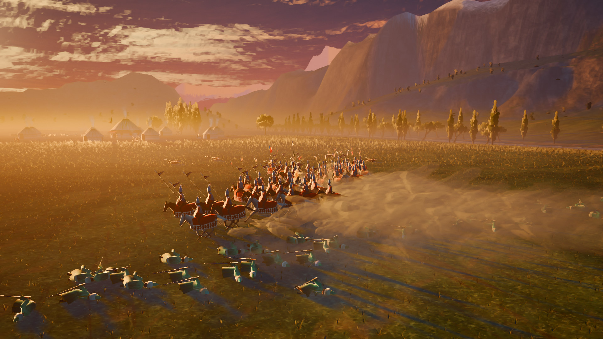

# Ордо — срез стиля

Этап 0 из [ТЗ](docs/TZ.md): одна сцена, чтобы согласовать новый стиль до остальной работы.
**Лагерь кыпчаков на закате и столкновение двух отрядов:** кокандские сарбозы с мылтыками
против кыпчакских сайыскеров и полководца Колбашчы.

| | |
|---|---|
|  |  |
|  |  |
|  |  |

## Как поиграть

**Windows.** Установщик и версия без установки — на странице
[Releases](https://github.com/Keepich1/KAGANFILM/releases) репозитория (собираются сами при каждом
изменении папки `ordo/`). При первом запуске Windows скажет «Windows защитила ваш компьютер» —
«Подробнее» → «Выполнить в любом случае»: у файла пока нет цифровой подписи.

**Из исходников (любая система).** Скачать [Godot 4.7.2](https://godotengine.org/download),
открыть `ordo/project.godot`, нажать F5.

## Управление

| Клавиши | Действие |
|---|---|
| W A S D, края экрана | сдвиг камеры |
| Колесо | ближе / дальше |
| Q / E, средняя кнопка | поворот и наклон камеры |
| 1–4 | готовые виды: всё поле, кокандская линия, конница, лагерь |
| C | кинокамера / камера стратегии |
| ЛКМ (двойной щелчок) | выбрать отряд (все такие) |
| P, + / − | пауза, скорость боя |
| R | бой заново |
| F1 | подсказка |
| F2 | качество «Высокое» / «Низкое» (ТЗ 11.7) |
| F9 | проверка скорости: +1000 → +3000 солдат → выкл, со счётчиком кадров |

## Что в срезе

- **Стиль (ТЗ 11.1).** Общий «живописный» свет для всех объектов: граница света ломается мазком,
  тени цветные (холодные сине-бирюзовые), тёплая полоса на границе света, контровой свет по краям
  силуэтов. Рисованные текстуры с мазками. Живописный фильтр кадра, туман в низинах, лучи, тени облаков.
- **Лагерь.** Боз үй по одобренному образцу (ТЗ 11.3): сетка верёвок на куполе, тюндюк, пояса
  завитков «кочкор мүйүз» и ромбов, резная дверь со свёрнутой кошмой. Хан ордосу со щитами
  и конскими кистями, туг с трезубцем и волнистым вымпелом, загоны, арбы, костры, дым из тюндюков.
  Малчы работают, отара пасётся, кони в загоне, стража у входа.
- **Юниты.** Сарбозы, знаменосцы, юзбоши, сайыскеры, Колбашчы, жоокеры, малчы, овцы, кони.
  Анимации на видеокарте (шаг, бег, рысь, галоп, натиск с копьём, залп с отдачей, удар,
  смерть, бегство, клич), 1000+ солдат в бою (ТЗ 11.5).
- **Бой.** Детерминированная симуляция с фиксированным шагом (ТЗ 4, 14): мораль, выносливость,
  натиск, залпы с точностью по дальности, аура и клич полководца, бегство. Рисованный пороховой
  дым, пыль из-под конницы, вспышки, искры.
- **Мир.** Долина у предгорий Тянь-Шаня: степь с ковылём, река с бродом, тополя и ивы,
  горы со снегом, рисованное закатное небо.

## Что ещё не сделано (честно)

- Вблизи юниты ещё «игрушечные» (гранёные рукава, руки-варежки); цвет стороны занимает больше
  30% силуэта; рабочие рубят и копают посохом.
- Рукопашная выглядит как две стенки, прижатые друг к другу.
- Деревья простоваты, у воды нет отражений, дальние пики на небе — плоские силуэты.
- На телефонах не проверено: вызовов отрисовки больше бюджета ТЗ (≈600 против 150–250).
- Звука пока нет.

## Вопросы к автору

1. **Стиль:** подходит ли направление? Что поправить в первую очередь?
2. **Движок (ТЗ 16.1):** срез сделан на Godot 4 по рекомендации ТЗ. Проверка скорости — F9 на вашем
   компьютере; пришлите кадры в секунду и модель видеокарты.
3. Название «Ордо» оставляем рабочим?

## Для разработчиков

- Правила проекта: [docs/CONTRACT.md](docs/CONTRACT.md). Главная сцена: `scenes/slice.tscn`.
- Модели и текстуры генерируются кодом: `python3 tools/gen_camp.py`, `gen_units.py`, `gen_world.py`,
  `gen_fx.py` (Python 3 + numpy + Pillow). Бюджеты ТЗ 11.5: `python3 tools/check_budgets.py`.
- Кадр без монитора: `tools/shot.sh res://scenes/slice.tscn out.png --cam=CamRTS --at=19`.
- Тесты боя: `godot --headless --path . --script res://tests/test_sim.gd`.
- Сборка для Windows: `tools/build_windows.sh 0.1.0` → `../build/windows/` (нужны шаблоны экспорта
  Godot и NSIS). На GitHub то же делает `.github/workflows/ordo-windows.yml`.
